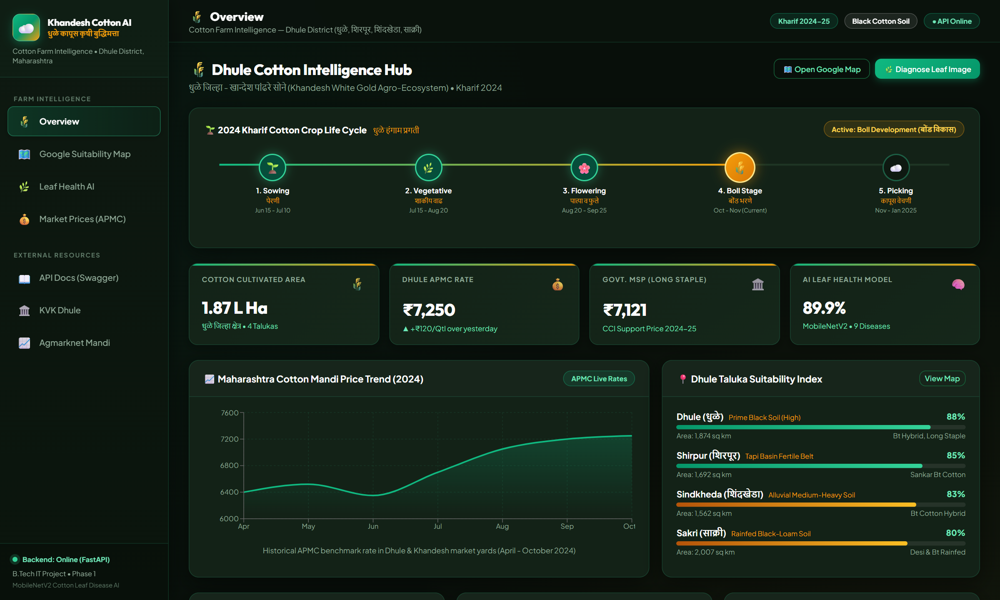
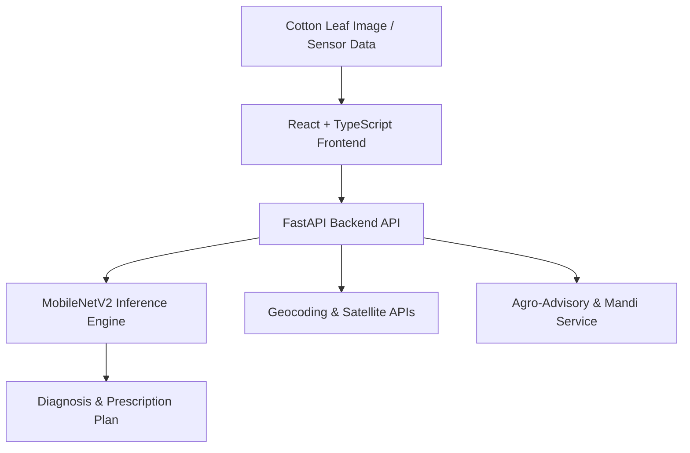

# 🌱 Cotton Farm Intelligence & Disease Detection System
> **AI-Driven Precision Agriculture & Decision Support Platform**  
> *Targeted Context: Cotton Cultivation in Dhule District, Khandesh Region, Maharashtra, India*



---

## 📌 Overview

**Cotton Farm Intelligence** is an end-to-end precision agriculture platform designed for cotton farmers and agricultural stakeholders in Maharashtra (specifically the Khandesh agro-climatic belt of Dhule, Jalgaon, and Nandurbar).

The platform bridges deep learning diagnostics with real-time farm management:
1. **Automated Foliar Disease Diagnosis**: MobileNetV2 transfer learning model trained on a leakage-proof dataset to classify 9 leaf conditions (Alternaria, Bacterial Blight, Fusarium Wilt, Verticillium Wilt, Powdery Mildew, Target Spot, Aphids, Army Worm, and Healthy Leaf).
2. **Interactive Intelligence Dashboard**: A modern React + TypeScript dashboard backed by a high-performance FastAPI service providing:
   - Geospatial land suitability analysis (soil pH, rainfall, elevation, NDVI)
   - Real-time weather advisories & pest outbreak alerts
   - Mandi price tracker & market intelligence (APMC Dhule, Shirpur, Jalgaon)
   - Leaf Health AI scanner with top-3 predictions and treatment guidance

---

## 🏗 System Architecture



### Key Components

- **Frontend (`cotton_farm_intelligence/frontend`)**:
  - React 19, TypeScript, Vite, Tailwind CSS / Lucide Icons.
  - Interactive maps, suitability layers, mandi charts, dynamic leaf health diagnosis upload modal.
- **Backend (`cotton_farm_intelligence/backend`)**:
  - FastAPI, Uvicorn, Pydantic, GeoPy, NumPy.
  - Modular REST endpoints for weather, soil, mandi rates, and disease inference.
- **Phase 1 Deep Learning (`phase1_cotton`)**:
  - MobileNetV2 transfer learning with PyTorch.
  - Disjoint Set Union (DSU) cluster splitting to prevent data leakage from pre-augmented duplicates.
  - Command-line inference tool with Top-3 probability scoring.
- **Presentation & Reports (`reports/`, `presentation_assets/`)**:
  - Comprehensive documentation, research paper summaries, slide deck presentations (PDF & PPTX).

---

## 🚀 Quick Start Guide

### 1. Prerequisites
- **Python 3.10+**
- **Node.js 18+** & npm

### 2. Launch Everything with One Click (Windows)
Double-click `START_DASHBOARD.bat` or run:
```bash
.\START_DASHBOARD.bat
```
This automatically boots both the backend (`http://localhost:8000`) and frontend (`http://localhost:5173`).

---

### 3. Manual Setup

#### Backend
```bash
cd cotton_farm_intelligence/backend
pip install -r requirements.txt
python -m uvicorn app.main:app --host 127.0.0.1 --port 8000 --reload
```
API Documentation will be live at: [http://localhost:8000/docs](http://localhost:8000/docs)

#### Frontend
```bash
cd cotton_farm_intelligence/frontend
npm install
npm run dev
```
Dashboard will be live at: [http://localhost:5173](http://localhost:5173)

---

## 🧪 Disease Detection Model (Phase 1)

The trained model baseline is stored in `phase1_cotton/models/best_cotton_mobilenetv2.pt`.

To run inference on a sample cotton leaf image from CLI:
```bash
python phase1_cotton/src/inference.py --image path/to/leaf.jpg
```

### Supported Classes:
1. `Alternaria Leaf Spot`
2. `Aphids`
3. `Army Worm`
4. `Bacterial Blight`
5. `Fusarium Wilt`
6. `Healthy Leaf`
7. `Powdery Mildew`
8. `Target Spot`
9. `Verticillium Wilt`

---

## 📊 Presentations & Project Reports
- Executive Presentation: [`Cotton_Farm_Intelligence_Presentation.pdf`](Cotton_Farm_Intelligence_Presentation.pdf)
- Full Project Report: [`reports/Complete_Cotton_Farm_Intelligence_Report.pdf`](reports/Complete_Cotton_Farm_Intelligence_Report.pdf)

---

## 📜 License
This project is open-source and intended for academic, research, and non-commercial agricultural advisory use.
